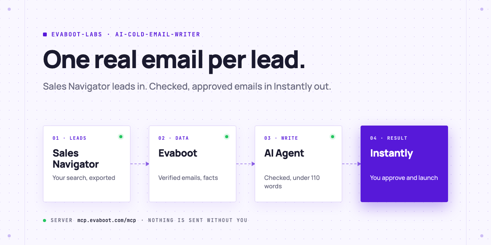
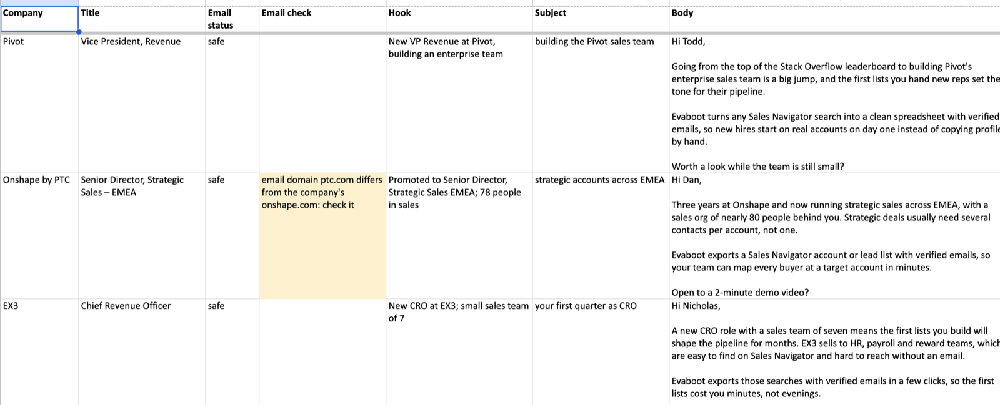
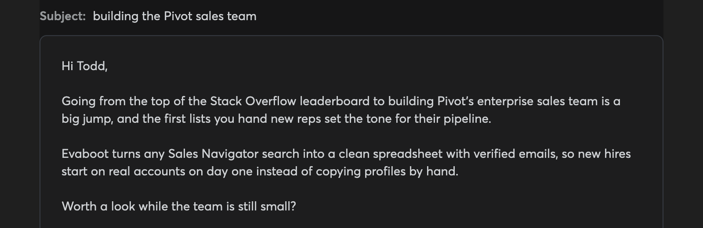
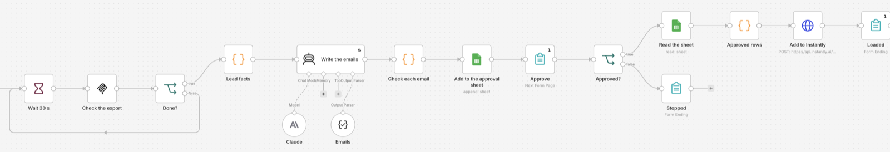

<picture>
  <source media="(prefers-color-scheme: dark)" srcset=".github/assets/banner-dark.png">
  
</picture>

# AI cold email writer

Your AI Agent exports leads from Sales Navigator with Evaboot, writes one short first email per lead from real facts, checks every email, and loads the ones you approve into Instantly. You launch the campaign.

[](AGENTS.md)
[](https://evaboot.com/mcp)
[](LICENSE)

## Set it up in one prompt

Paste this into Claude Code, Codex or Cursor:

```text
Clone https://github.com/evaboot-labs/ai-cold-email-writer, read AGENTS.md and follow the skill. Write cold emails for my next 20 leads.
```

<details>
<summary>Or install the skill</summary>

Claude Code:

```text
/plugin marketplace add evaboot-labs/ai-cold-email-writer
/plugin install ai-cold-email-writer@evaboot-labs-ai-cold-email-writer
```

Codex, Cursor and other agents:

```bash
npx skills add evaboot-labs/ai-cold-email-writer
```

</details>

## How it works

**1. One email per lead, from real facts.** Each email names its hook (a new role, company growth, a line of the lead's own profile), stays under 110 words, and has no link. A script checks length, template phrases, repeated openings and the email domain.



**2. Approved rows go to Instantly.** The body lands in `{{personalization}}` and the subject in `{{ai_subject}}`, so the campaign step shows the email the AI wrote. Only verified emails are loaded.



**3. Or run it in n8n.** A form takes your search, Claude writes the emails into your sheet, and a second form page loads the rows you marked yes.



## What you need

- An [Evaboot account](https://dash.evaboot.com/accounts/signup/?last_click_origin=ai-cold-email-writer-repo) and a Sales Navigator seat.
- An Instantly account with a campaign set up as in [docs/instantly.md](docs/instantly.md), or any outreach tool that takes a CSV with a custom body, such as lemlist.
- An AI Agent that can use an MCP server: Claude Code, Codex, Cursor, or Claude and ChatGPT on the web.
- Python 3.9+, with no packages to install.
- Cost: 1 Evaboot credit per exported lead. The search preview is free.

## Go further

| Page | For |
|---|---|
| [docs/connect-your-agent.md](docs/connect-your-agent.md) | The setup by hand, for each agent |
| [docs/instantly.md](docs/instantly.md) | The Instantly campaign the emails load into |
| [docs/n8n.md](docs/n8n.md) | The same agent in n8n, from a form |
| [OFFER.md](OFFER.md) | Your offer and the rules every email follows |

---

Agents: start at [AGENTS.md](AGENTS.md) · Built by [Evaboot](https://evaboot.com) · More workflows at [github.com/evaboot-labs](https://github.com/evaboot-labs) · [MIT license](LICENSE)
